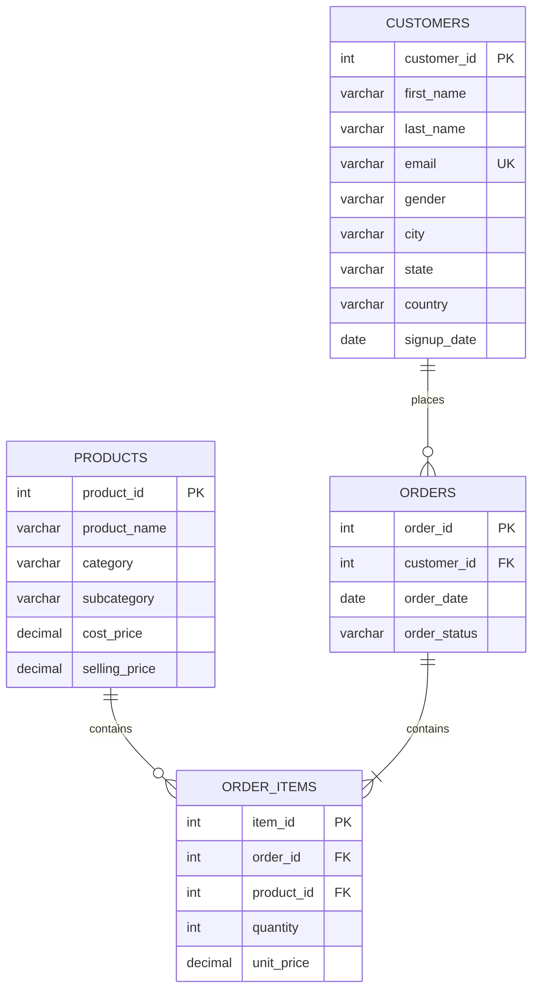

# E-Commerce Sales Analytics Dashboard

A professional-grade, end-to-end Business Intelligence (BI) and Data Analytics platform. This project simulates a real-world enterprise dashboard utilized by executive leadership teams to make data-driven decisions regarding sales performance, customer cohorts, product margins, and regional growth.

The system processes **100,000+ transactional orders**, **10,000 customers**, and **2,000 products** spanning a multi-year period (2022–2026), exposing advanced SQL queries, KPI aggregations, and automatic business insights through a premium, responsive dashboard interface.

---

## 🚀 Resume Showcase Ready

Include this entry directly on your resume:

> **E-Commerce Sales Analytics Dashboard** | *SQL, PostgreSQL, Node.js, Express, Vanilla CSS, ApexCharts, Docker*
> - Developed an end-to-end business intelligence solution analyzing 100,000+ orders and 10,000+ customers.
> - Built advanced SQL queries utilizing CTEs, window functions, and multi-table joins to compute customer segmentation (RFM) and cohort-based customer lifetime value (LTV).
> - Created an interactive dashboard featuring executive KPIs, interactive scatter matrices, treemaps, dynamic insights engines, and a custom SQL query console allowing recruiters to execute live read-only SQL queries.

---

## 🛠️ Technology Stack

* **Frontend**: HTML5, Vanilla CSS3 (Glassmorphism design, Light/Dark modes), ApexCharts.js (interactive charting engine), FontAwesome 6.
* **Backend**: Node.js, Express.js.
* **Database**: PostgreSQL (Production) / SQLite (Zero-config development fallback).
* **Containerization**: Docker, Docker Compose.

---

## 📊 Database Schema

The database follows a normalized relational structure:



* **Customers**: 10,000 records with realistic geographic distribution (US, India, UK, Germany) and signup dates.
* **Products**: 2,000 categorized inventory items (Electronics, Fashion, Home & Kitchen, Sports, Beauty, Books) with subcategories and cost-to-sell price margins.
* **Orders**: 100,000 transactional orders with realistic statuses (Delivered, Returned, Cancelled, Processing) distributed seasonally from 2022 to 2026.
* **Order Items**: ~220,000 lines linking items within orders with quantity multipliers.

---

## 🧠 Advanced SQL Queries Included

All queries are fully parameterized and optimized with appropriate database index design:

### 1. RFM Customer Segmentation (NTILE Window Function)
Splits customers into four tiers: **Platinum**, **Gold**, **Silver**, and **Bronze** based on purchase Recency, Frequency, and Monetary value.
```sql
WITH customer_rfm AS (
    SELECT 
        c.customer_id,
        COALESCE(CAST(EXTRACT(EPOCH FROM (CAST('2026-06-01' AS DATE) - o.order_date))/86400 AS INT), 9999) AS recency,
        COUNT(DISTINCT o.order_id) AS frequency,
        COALESCE(SUM(oi.quantity * oi.unit_price), 0) AS monetary
    FROM customers c
    LEFT JOIN orders o ON c.customer_id = o.customer_id AND o.order_status != 'Cancelled'
    LEFT JOIN order_items oi ON o.order_id = oi.order_id
    GROUP BY c.customer_id
),
rfm_scores AS (
    SELECT 
        *,
        NTILE(4) OVER (ORDER BY recency ASC) AS r_score,
        NTILE(4) OVER (ORDER BY frequency DESC) AS f_score,
        NTILE(4) OVER (ORDER BY monetary DESC) AS m_score
    FROM customer_rfm
)
SELECT 
    customer_id,
    (r_score + f_score + m_score) AS total_score,
    CASE 
        WHEN (r_score + f_score + m_score) <= 5 THEN 'Platinum'
        WHEN (r_score + f_score + m_score) <= 8 THEN 'Gold'
        WHEN (r_score + f_score + m_score) <= 10 THEN 'Silver'
        ELSE 'Bronze'
    END AS segment
FROM rfm_scores;
```

### 2. Cohort Retention Customer Lifetime Value (LTV)
Analyzes month-over-month signups and traces cumulative cohort spend over time.
```sql
WITH customer_cohorts AS (
    SELECT customer_id, TO_CHAR(signup_date, 'YYYY-MM') AS cohort_month FROM customers
),
order_revenues AS (
    SELECT o.customer_id, o.order_date, SUM(oi.quantity * oi.unit_price) AS order_revenue
    FROM orders o JOIN order_items oi ON o.order_id = oi.order_id
    WHERE o.order_status != 'Cancelled' GROUP BY o.customer_id, o.order_date
),
cohort_revenue_timeline AS (
    SELECT 
        cc.cohort_month, cc.customer_id, r.order_revenue,
        CAST(EXTRACT(YEAR FROM r.order_date) - EXTRACT(YEAR FROM TO_DATE(cc.cohort_month || '-01', 'YYYY-MM-DD')) AS INT) * 12 + 
        CAST(EXTRACT(MONTH FROM r.order_date) - EXTRACT(MONTH FROM TO_DATE(cc.cohort_month || '-01', 'YYYY-MM-DD')) AS INT) AS months_active
    FROM customer_cohorts cc JOIN order_revenues r ON cc.customer_id = r.customer_id
)
SELECT 
    cohort_month, COUNT(DISTINCT customer_id) AS cohort_size,
    SUM(CASE WHEN months_active = 0 THEN order_revenue ELSE 0 END) / COUNT(DISTINCT customer_id) AS month_0_ltv,
    SUM(order_revenue) / COUNT(DISTINCT customer_id) AS total_average_ltv
FROM cohort_revenue_timeline
GROUP BY cohort_month ORDER BY cohort_month ASC;
```

---

## ⚡ Dynamic Features

1. **Global Dashboard Filters**: Change dates, categories, regions, or customer segments to instantly update all visualizations via dynamic query compilation.
2. **SQL Console**: Execute read-only SQL queries directly against the database in the UI. Inspect columns and sort data in a responsive grid.
3. **Insights Engine**: Auto-generates critical business notices based on aggregate margins, sales shares, return rates, and churn risk.
4. **Light/Dark Toggle**: Premium CSS variable theme manager.
5. **Exports Hub**: Download analytical data representations instantly as CSV or generate executive PDF print configurations.

---

## ⚙️ Quick Start Instructions

Ensure you have **Node.js (18+)** installed.

### Option 1: Run Locally (SQLite Fallback - Fast)
This starts the app instantly using SQLite without requiring PostgreSQL configurations:
```bash
# 1. Install dependencies
npm install

# 2. Run schema setup and seed SQLite file
npm run seed

# 3. Start local development server
npm start
```
Go to `http://localhost:3000` to preview.

### Option 2: Run with Docker (PostgreSQL - Full BI Environment)
This spins up a dedicated PostgreSQL database container and automatically builds, links, seeds, and executes the web application container:
```bash
# Start Docker compose
docker-compose up --build
```
Go to `http://localhost:3000` to preview.

---

## 💡 Future Enhancements
* Incorporate machine-learning powered forecasting for sales trends using Node.js regression algorithms.
* Add basket-analysis queries (frequently bought together items) using APriori algorithms in SQL.
* Expand the regional performance view with visual maps (Leaflet or D3.js).
